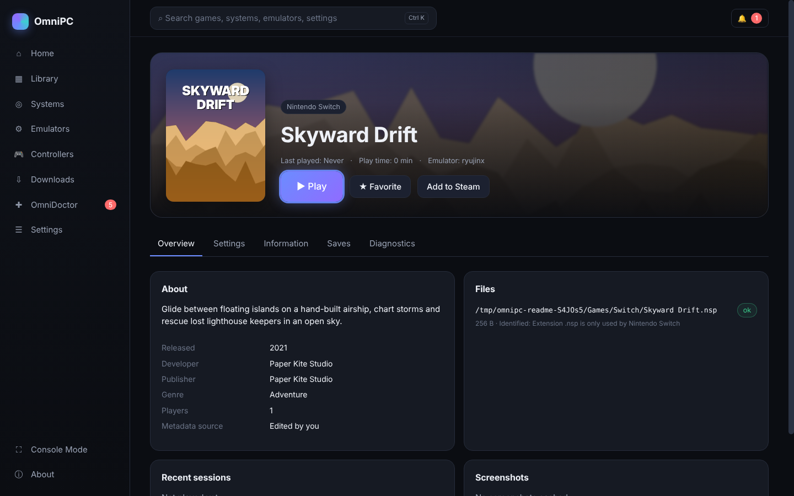
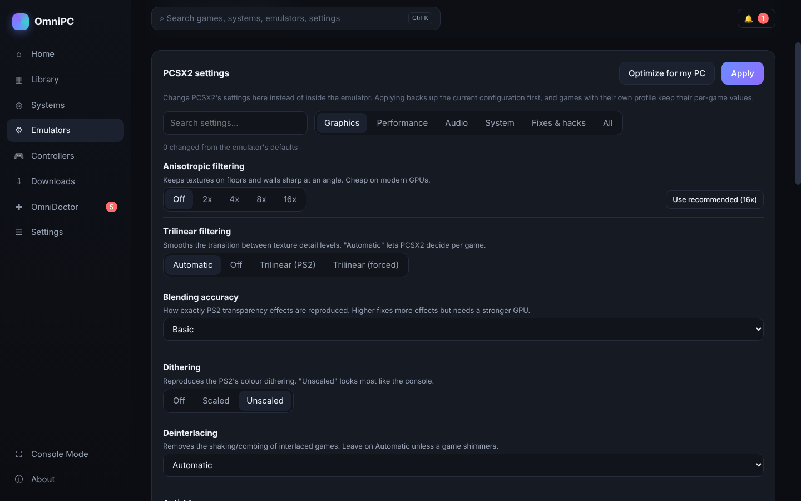
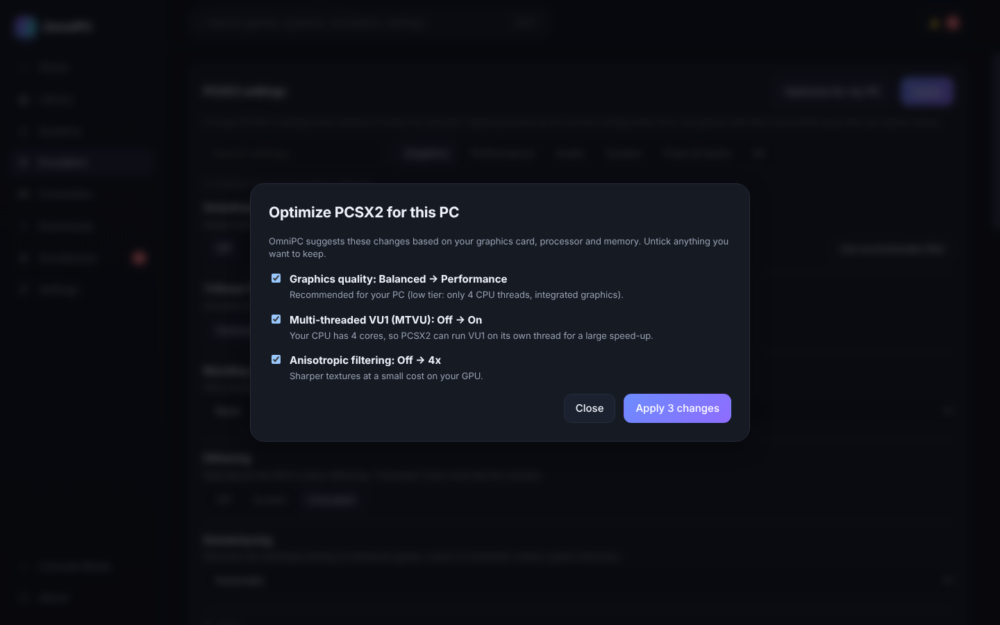
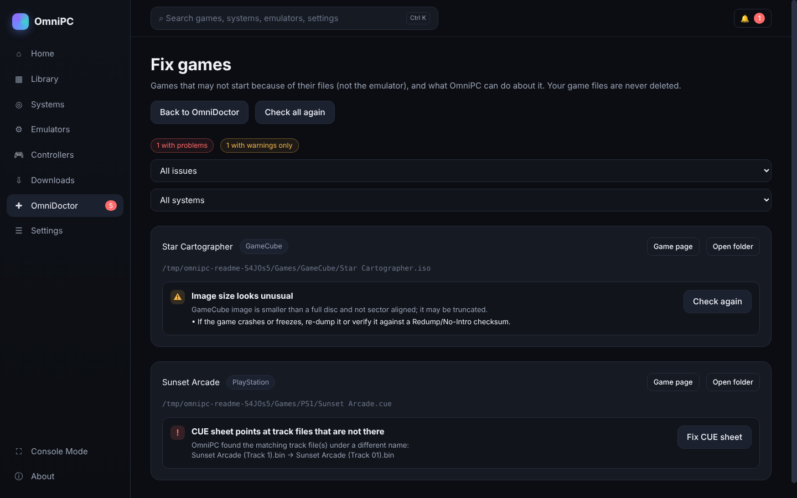
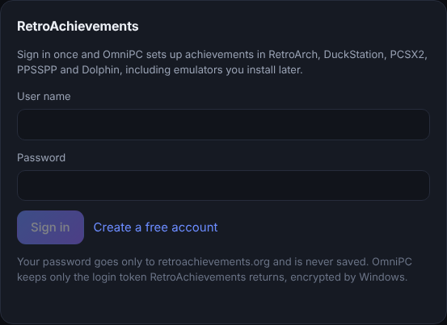
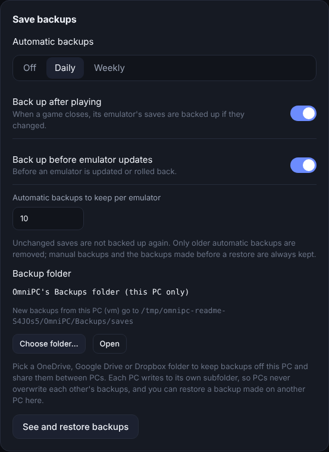

<div align="center">


# OmniPC

**Every console. One app. Zero config files.**

An all-in-one emulation frontend for Windows. OmniPC installs and updates your emulators,
builds one library from all your game folders, sets up your controller once for everything,
and when something breaks, it tells you why and fixes it.

[](https://github.com/onlykappa/OmniPC/actions/workflows/ci.yml)
[](../../releases/latest)


[**⬇ Download**](../../releases/latest) · [User guide](docs/USER_GUIDE.md) · [What works](docs/STATUS.md) · [Troubleshooting](docs/TROUBLESHOOTING.md) · [Changelog](CHANGELOG.md)


<sub>Screenshots show a demo library of made-up games with original artwork.</sub>

</div>

---

> **New in 1.3: The Customizability Update.** Change every emulator's settings inside OmniPC:
> 13 emulators, over 340 settings, each explained in plain English. Set them per game, or let
> **Optimize for my PC** pick the best ones for your hardware.

## Highlights

- 🎮 **One library for everything.** 21 systems, identified by what's inside the files, with box
  art, screenshots and descriptions.
- ⚙️ **Emulators that just work.** One-click install from official sources, configured for your
  PC, updated with one click, and rolled back automatically if an update breaks something.
- 🎛️ **Every setting in one place.** No more digging through each emulator's menus.
- 🩺 **OmniDoctor.** Health checks, crash analysis and safe repairs for both emulators and game files.
- 🕹️ **One controller setup.** Map once; OmniPC writes it into every emulator.
- 🏆 **RetroAchievements, Steam and save sync.** Sign in once, add games to Steam, and back up
  saves to your cloud folder.
- 🔄 **Updates itself.** New versions install with one click from inside the app.

## Features

<table>
<tr>
<td width="50%" valign="top">

### 🎮 One library
Point OmniPC at your game folders, even across drives. It recognises games by their contents
(disc headers, `PARAM.SFO`, XBE/XEX, Switch title IDs), groups multi-disc games and
Switch updates/DLC, flags broken dumps, and remembers games on unplugged drives.

Box art, screenshots and descriptions come from free sources that need no account:
libretro-thumbnails, GameTDB, Nintendo eShop listings and Wikipedia.

</td>
<td width="50%" valign="top">


</td>
</tr>
<tr>
<td valign="top">



</td>
<td valign="top">

### 🕹️ Every game, ready to play
Each game has its own page with artwork, details, play history, saves and diagnostics.
Choose a different emulator or give one game its own settings, and OmniPC brings
them back after you play.

</td>
</tr>
<tr>
<td valign="top">

### 🎛️ Every emulator setting, in one menu
Graphics, performance, audio, system and fixes for all 13 emulators. Each setting is explained
in plain English, shows the emulator's default and OmniPC's recommendation, and warns you
before you touch a risky hack. Changes made inside an emulator show up here too, and every
change is backed up first.

</td>
<td valign="top">



</td>
</tr>
<tr>
<td valign="top">



</td>
<td valign="top">

### ⚡ Optimize for my PC
OmniPC reads your graphics card, processor and memory and suggests the best settings for each
emulator, or for all of them at once. Every suggestion comes with a reason, and you can untick
anything before applying.

</td>
</tr>
<tr>
<td valign="top">

### 🩺 OmniDoctor
A health score with evidence, log analysis, and "this started after the update" detection.
Repairs are labelled by safety, backed up and undoable. **Fix games** repairs the games
themselves: CUE sheets pointing at renamed tracks, broken multi-disc playlists, zipped disc
images and more.

</td>
<td valign="top">



</td>
</tr>
<tr>
<td valign="top">



</td>
<td valign="top">

### 🏆 RetroAchievements
Sign in once and achievements work in RetroArch, DuckStation, PCSX2, PPSSPP and Dolphin,
including emulators you install later. Hardcore mode is one switch. Your password is never
stored; OmniPC keeps only the login token, encrypted by Windows.

</td>
</tr>
<tr>
<td valign="top">

### 💾 Save backups that sync
Automatic backups every day or week, after you play, and before every emulator update. Point
them at OneDrive, Google Drive or Dropbox to keep your saves safe and move them between PCs.
Restores always back up your current saves first.

</td>
<td valign="top">



</td>
</tr>
<tr>
<td valign="top">


</td>
<td valign="top">

### 📺 Couch-ready
**Console Mode** is a fullscreen interface you drive with a controller alone. **Add to Steam**
puts your games in Steam with their box art, so they launch from Big Picture or Steam Link.

</td>
</tr>
</table>

<details>
<summary><b>More screenshots</b></summary>


</details>

## Supported systems

| System | Emulator | You need to supply |
|---|---|---|
| PlayStation | DuckStation | PS1 BIOS |
| PlayStation 2 | PCSX2 | PS2 BIOS |
| PlayStation 3 | RPCS3 | PS3 system software (`PS3UPDAT.PUP` from Sony) |
| PlayStation Portable | PPSSPP | — |
| PlayStation 4 | shadPS4 | — (firmware modules optional; AVX2 CPU, Vulkan GPU) |
| PlayStation 5 *(experimental)* | KytyPS5 | — (Vulkan 1.3 GPU) |
| Nintendo Switch | Ryujinx | `prod.keys` + firmware from your own Switch |
| GameCube · Wii | Dolphin | — |
| Wii U | Cemu | Keys for encrypted dumps (or dump decrypted) |
| Nintendo DS | melonDS | — (BIOS optional) |
| Xbox | xemu | MCPX boot ROM, BIOS, HDD image |
| Xbox 360 | Xenia Canary | — |
| NES · SNES · N64 · Game Boy / Color / Advance · Genesis · Arcade | RetroArch | — |

Every emulator is downloaded from its **official** source and checksum-verified when the project
publishes one. Updates keep the previous version, so you can roll back with one click.
**Scan for BIOS & keys** finds the files you already have and puts them in the right place.

## Install

1. Download **OmniPC-Setup-&lt;version&gt;.exe** from the [latest release](../../releases/latest).
2. Run it. OmniPC installs for your user only and never runs as Administrator.
3. The first-run wizard scans your PC, asks which systems you want and where your games are,
   sets up your controller and installs the emulators.
4. Add BIOS, firmware and keys from your own consoles (**Emulators → BIOS & Firmware → Scan**).

After that, OmniPC updates itself: **Settings → Updates**. Windows SmartScreen may warn about
the installer because it is unsigned; choose **More info → Run anyway**.

## Your files, your responsibility

OmniPC **never** downloads or distributes games, BIOS files, firmware or encryption keys, and
never circumvents copy protection. Use games and system files you dumped from hardware you own.
Diagnostic packages and the optional AI troubleshooter never include games, BIOS, keys, saves or
personal documents.

## Build from source

Requirements: Node.js 22+ and npm 10+. You need Windows 10/11 x64 for the full experience; the app
and its test suite also run on Linux and macOS, where Windows-only features are marked as unavailable.

```bash
npm install
npm run dev          # Vite + Electron with hot reload
npm test             # unit, integration and end-to-end tests
npm run typecheck
npm run dist         # Windows installer → release/OmniPC-Setup-<version>.exe
```

Adding an emulator takes one adapter and a manifest; see [docs/ADAPTERS.md](docs/ADAPTERS.md).
To regenerate the README screenshots, see `scripts/readme/screenshots.mjs`.

## Documentation

| | |
|---|---|
| [User guide](docs/USER_GUIDE.md) | [Troubleshooting](docs/TROUBLESHOOTING.md) |
| [What works today](docs/STATUS.md) | [Windows testing checklist](docs/TESTING_CHECKLIST.md) |
| [Architecture](docs/ARCHITECTURE.md) | [Writing an adapter](docs/ADAPTERS.md) |
| [OmniDoctor rules](docs/DIAGNOSTIC_RULES.md) | [Database](docs/DATABASE.md) |
| [Security](docs/SECURITY.md) | [Licensing](docs/LICENSING.md) |
| [Development](docs/DEVELOPMENT.md) | [Release process](docs/RELEASE.md) |

## License

OmniPC is released under the [MIT License](LICENSE). Emulators are downloaded from their official
sources and remain under their own licenses; see [THIRD_PARTY_NOTICES.md](THIRD_PARTY_NOTICES.md).

OmniPC is an independent project. It is not affiliated with EmuDeck, Sony, Nintendo, Microsoft,
Sega, Valve, RetroAchievements or any emulator project. Product names are used only to identify
compatibility.
