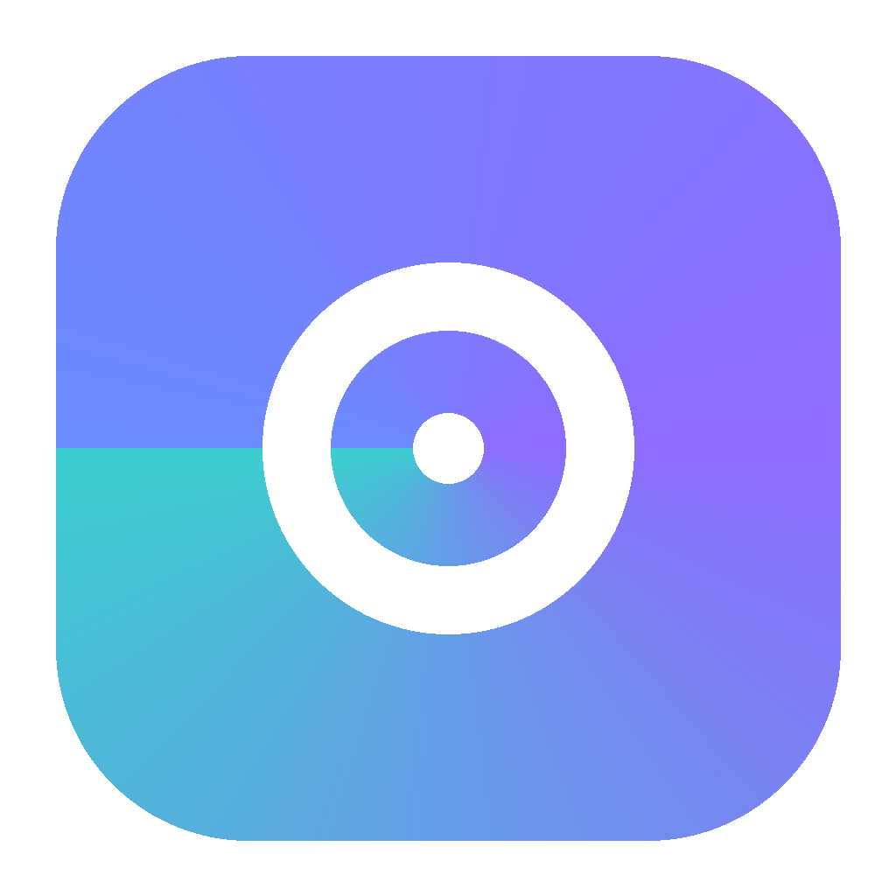
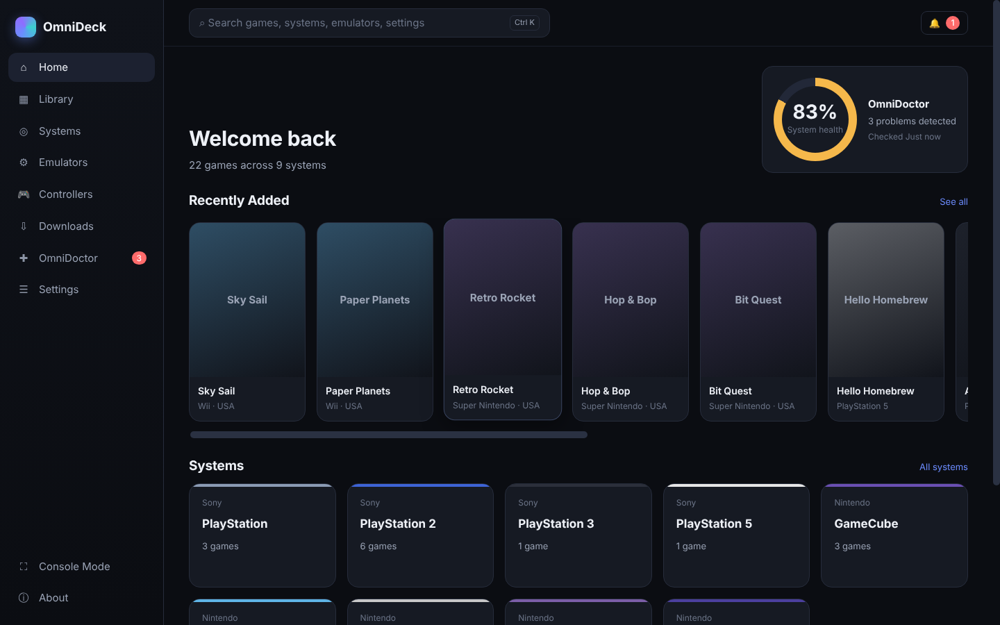
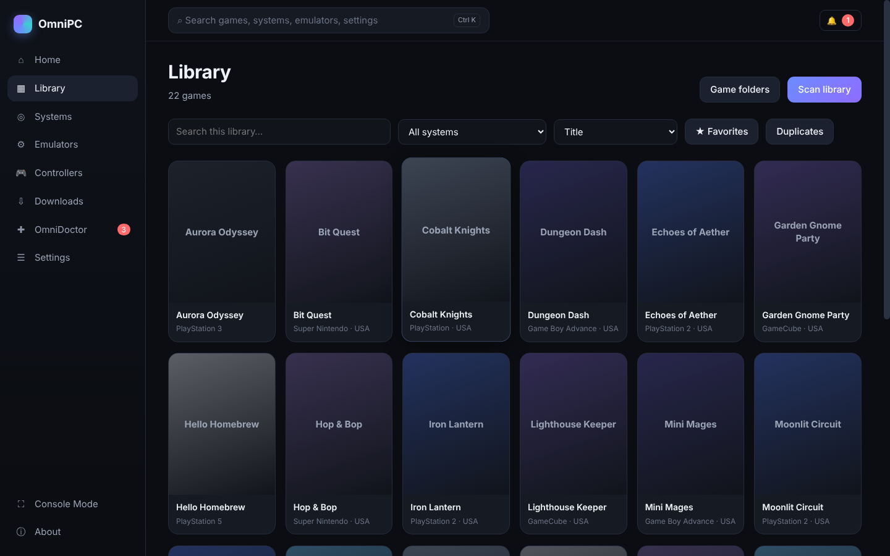
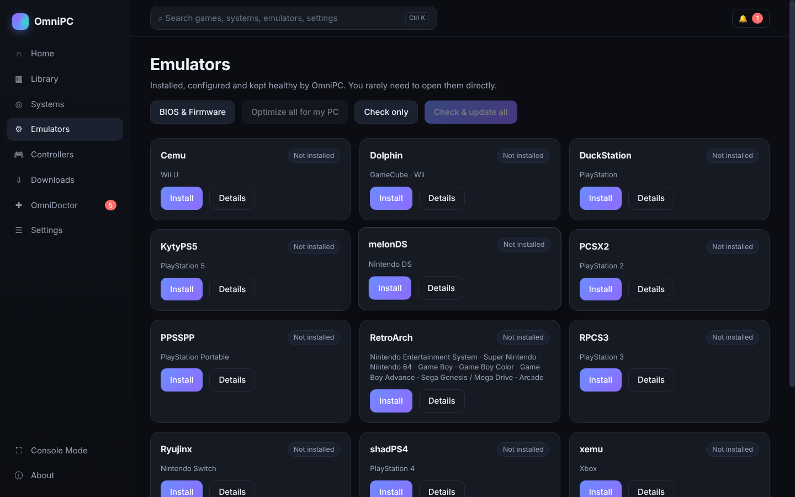
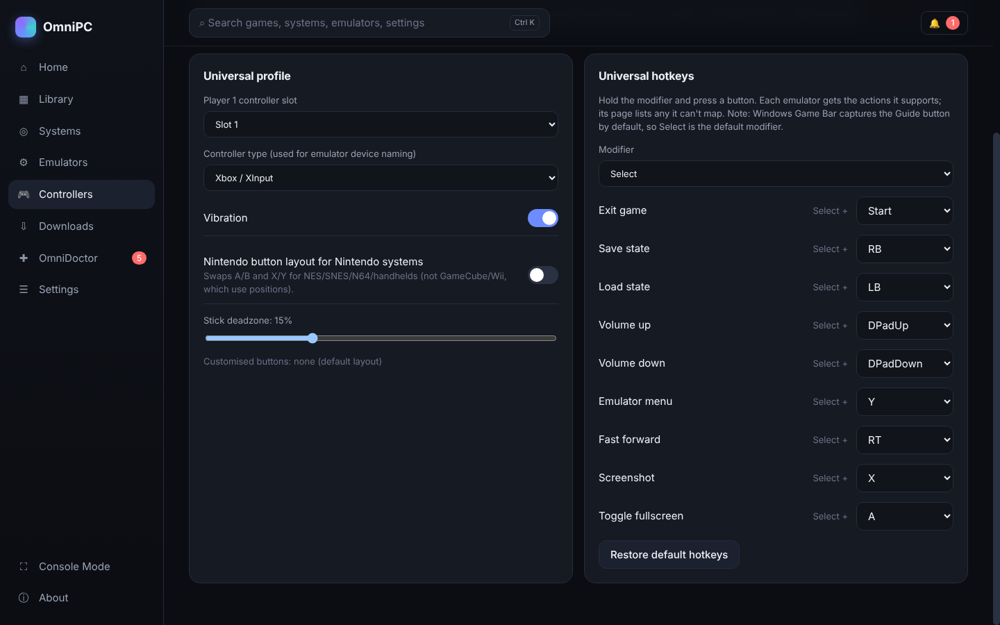
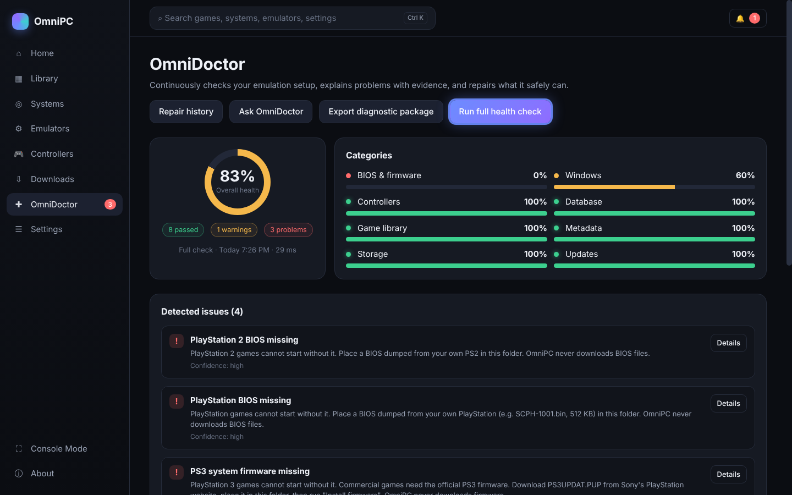
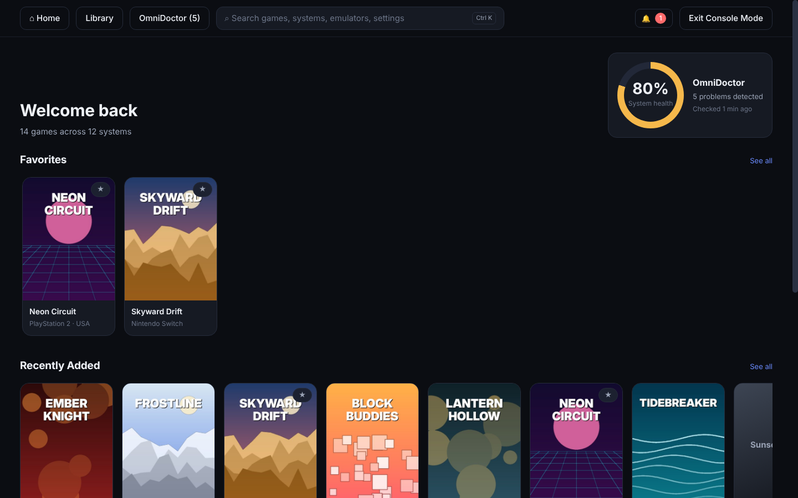
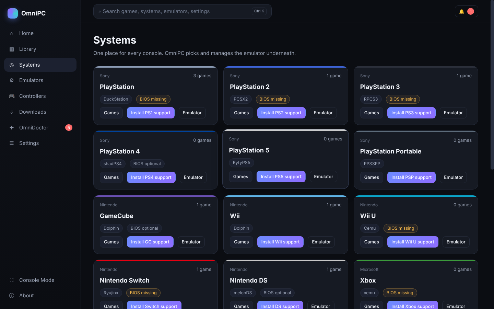

<div align="center">



# OmniPC

**Every console. One app. Zero config files.**

OmniPC installs your emulators, builds one library from all your game folders, maps your
controller once for every emulator, and when something breaks, tells you why and fixes it.

[](https://github.com/onlykappa/OmniPC/actions/workflows/ci.yml)


[**Download**](../../releases/latest) · [User guide](docs/USER_GUIDE.md) · [What works](docs/STATUS.md) · [Troubleshooting](docs/TROUBLESHOOTING.md)



</div>

---

## Supported systems

| System | Emulator | You need to supply |
|---|---|---|
| PlayStation | DuckStation | PS1 BIOS |
| PlayStation 2 | PCSX2 | PS2 BIOS |
| PlayStation 3 | RPCS3 | PS3 system software (`PS3UPDAT.PUP` from Sony) |
| PlayStation Portable | PPSSPP | — |
| PlayStation 4 | shadPS4 | — (firmware modules optional; AVX2 CPU, Vulkan GPU) |
| Nintendo Switch | Ryujinx (Ryubing) | `prod.keys` + firmware from your own Switch |
| PlayStation 5 *(experimental)* | KytyPS5 | — (Vulkan 1.3 GPU) |
| GameCube · Wii | Dolphin | — |
| Wii U | Cemu | Keys for encrypted dumps (or dump decrypted) |
| Nintendo DS | melonDS | — (BIOS optional) |
| Xbox | xemu | MCPX boot ROM, BIOS, HDD image |
| Xbox 360 | Xenia Canary | — |
| NES · SNES · N64 · Game Boy / Color / Advance · Genesis · Arcade | RetroArch | — |

Each emulator is downloaded from its **official** source, checksum-verified when the project
publishes one, and configured for your hardware. Updates keep the previous version so you can
roll back in one click.

## Features

<table>
<tr>
<td width="50%" valign="top">

### 🎮 One library
Point OmniPC at your game folders, across drives. It identifies games by their contents,
not just file names: disc headers, `SYSTEM.CNF`, `PARAM.SFO` and PS3/PS5 game folders. It
groups multi-disc games, flags broken dumps, and remembers games on drives that are unplugged.

</td>
<td width="50%" valign="top">



</td>
</tr>
<tr>
<td valign="top">



</td>
<td valign="top">

### ⚙️ Emulators that just work
One click installs and configures each emulator. OmniPC turns off first-run wizards,
update nags and exit confirmations, so games start fullscreen and closing them brings you
back. Saves live in one OmniPC folder that survives updates. Sign in to RetroAchievements
once and achievements work in RetroArch, DuckStation, PCSX2, PPSSPP and Dolphin.

</td>
</tr>
<tr>
<td valign="top">

### 🕹️ Set up your controller once
Map your controller and hotkeys once (exit, save/load state, fast-forward, volume) and OmniPC
writes them into every emulator's own format. There's an optional Nintendo button layout for
Nintendo systems.

</td>
<td valign="top">



</td>
</tr>
<tr>
<td valign="top">



</td>
<td valign="top">

### 🩺 OmniDoctor
Health checks with a real score, log analysis, and "this started after the update" detection.
Every diagnosis shows its evidence and confidence. Repairs are labelled by safety level and
backed up first, and you can undo them.

</td>
</tr>
<tr>
<td valign="top">

### 📺 Console Mode
A fullscreen, controller-only interface for the couch, so you can browse, launch and manage
everything without a keyboard.

</td>
<td valign="top">



</td>
</tr>
</table>

<details>
<summary><b>More screenshots</b></summary>



</details>

## Install

1. Download **OmniPC-Setup-<version>.exe** from the [latest release](../../releases/latest).
2. Run it. OmniPC installs per-user and never runs as Administrator. It asks for elevation
   only for specific tasks, such as installing the Visual C++ runtime, and explains why.
3. The first-run wizard scans your PC, asks which systems you want and where your games are,
   sets up your controller, and installs the emulators.
4. Put BIOS/firmware files from your own consoles in the folders OmniPC shows you
   (**Emulators → BIOS & Firmware**).

Windows SmartScreen may warn about an unsigned installer. Choose **More info → Run anyway**.

## Your files, your responsibility

OmniPC **never** downloads or distributes games, BIOS files, firmware or encryption keys,
and never circumvents copy protection. Use games and system files you dumped from hardware
you own. Diagnostic packages and the optional AI troubleshooter exclude games, BIOS, keys,
saves and personal documents.

## Build from source

Requirements: Node.js 22+, npm 10+. Windows 10/11 x64 for the full experience. The app and
test suite also run on Linux and macOS, where Windows-only features report themselves as
unavailable.

```bash
npm install
npm run dev          # Vite + Electron with hot reload
npm test             # unit, integration and end-to-end tests
npm run typecheck
npm run dist         # Windows installer → release/OmniPC-Setup-<version>.exe
```

Adding an emulator means writing one adapter and a manifest; see
[docs/ADAPTERS.md](docs/ADAPTERS.md).

## Documentation

| | |
|---|---|
| [User guide](docs/USER_GUIDE.md) | [Troubleshooting](docs/TROUBLESHOOTING.md) |
| [What works today](docs/STATUS.md) | [Windows testing checklist](docs/TESTING_CHECKLIST.md) |
| [Architecture](docs/ARCHITECTURE.md) | [Writing an adapter](docs/ADAPTERS.md) |
| [OmniDoctor rules](docs/DIAGNOSTIC_RULES.md) | [Database](docs/DATABASE.md) |
| [Security](docs/SECURITY.md) | [Licensing](docs/LICENSING.md) |
| [Development](docs/DEVELOPMENT.md) | [Release process](docs/RELEASE.md) |

## License

OmniPC is released under the [MIT License](LICENSE). Emulators are downloaded from their
official sources and remain under their own licenses; see
[THIRD_PARTY_NOTICES.md](THIRD_PARTY_NOTICES.md).

OmniPC is an independent project. It is not affiliated with EmuDeck, Sony, Nintendo,
Microsoft, Sega or any emulator project. Product names are used only to identify compatibility.
